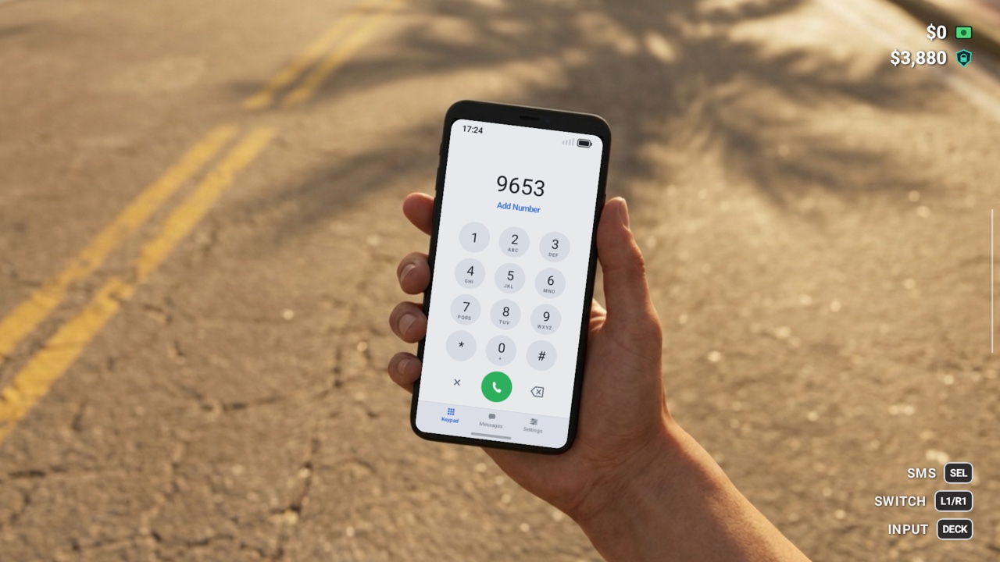
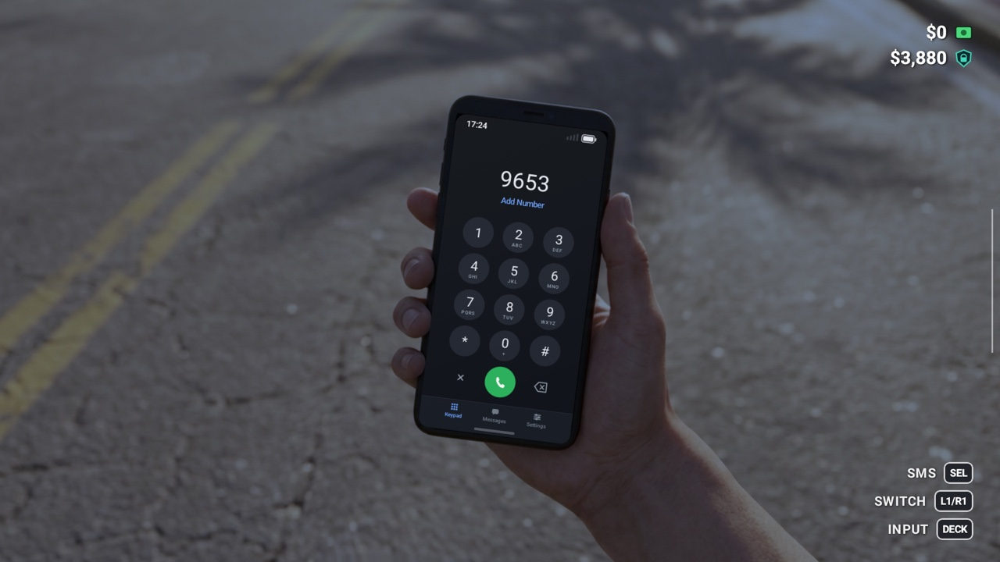
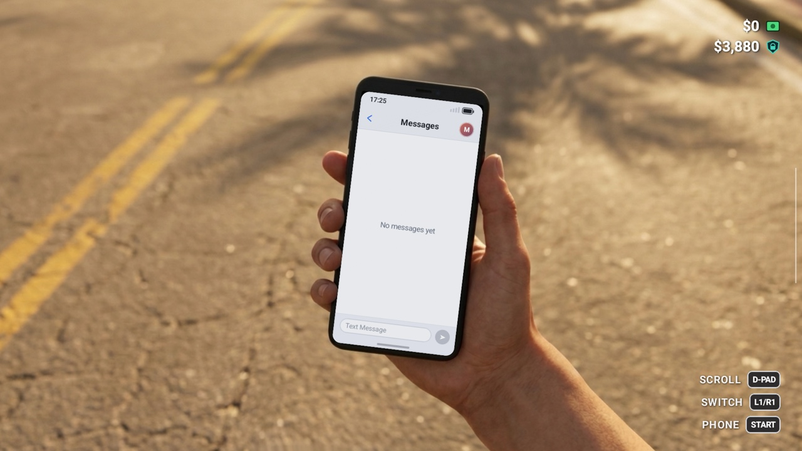
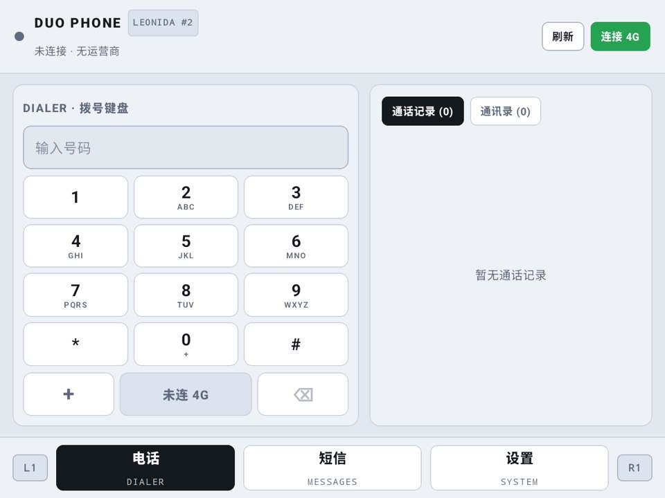
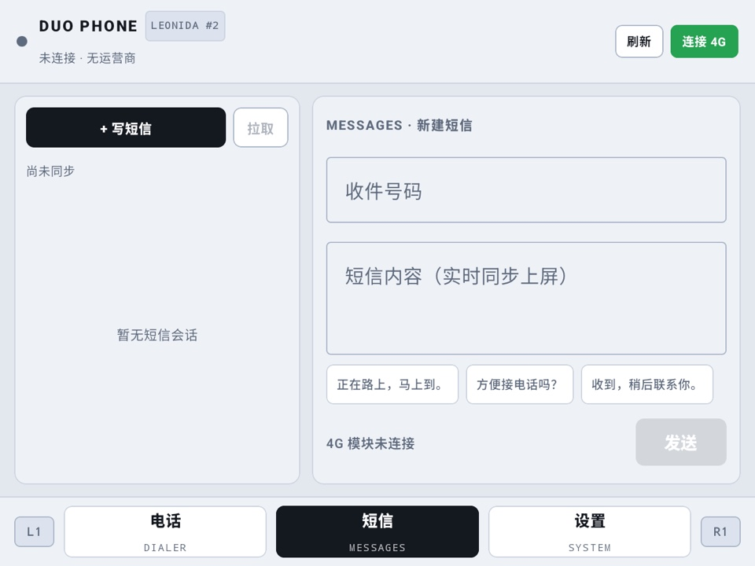
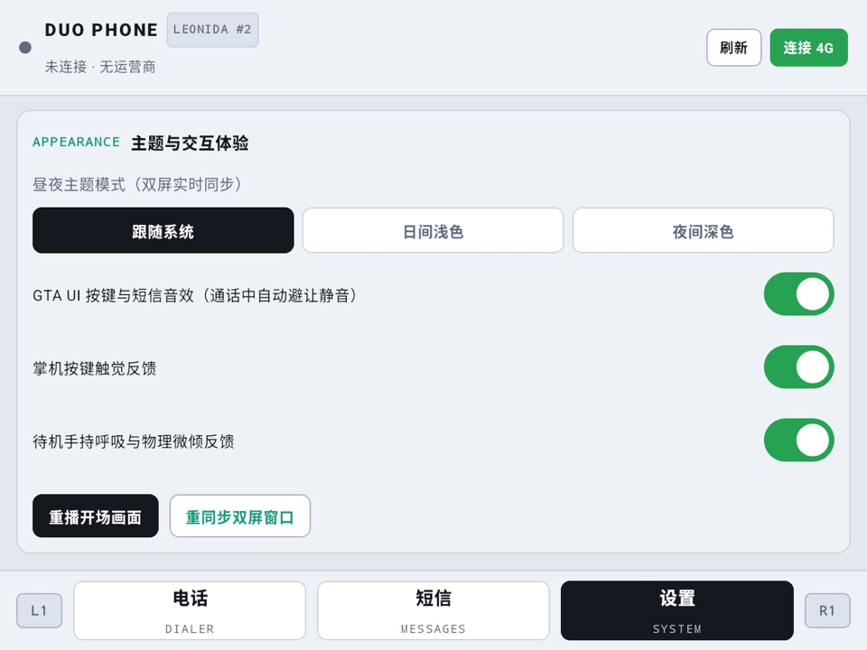
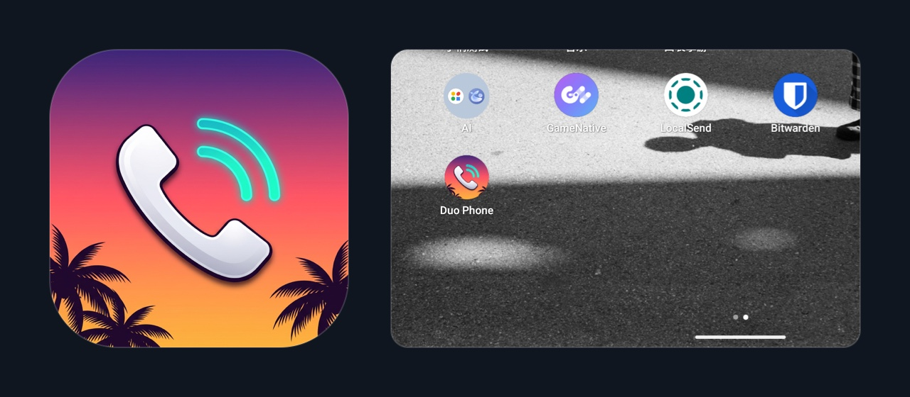

[中文](README.md) | [English](README_EN.md)

# Duo Phone

[-34B864?style=flat-square)](https://developer.android.com/)
[](https://kotlinlang.org/)
[](#核心架构与硬件支持)
[](#-使用-gemini-开发)
[](LICENSE)

面向 **Retroid Pocket Duo** 双屏游戏掌机（Android 16 / SDK 36）与 **大疆第一代 4G 增强图传模块（DJI Cellular Dongle Gen 1 / QDC507 / MDM9207）** 的独立 **非 Root** 蜂窝通信终端应用。

无需刷写模块固件、无需 Root 掌机系统，通过 USB Type-C OTG 即可在掌机上实现完整的 **4G 语音通话、双向中文/长短信收发、联系人来电匹配、手柄快捷操控**，以及参考 **GTA 6（Leonida / Vice City）** 视觉风格打造的双屏沉浸式交互体验。

---

## 📸 界面展示与图标设计

### 上屏视觉舞台（`Display #0` · `1920×1080`）

上屏呈现第一人称手持智能手机的沉浸式通信舞台：支持 **日间/夜间主题自适应渲染**、四点透视同调贴合（`rx=0°, ry=0°, rz=+7°`）、自然微倾呼吸感以及真实信号格数 / 电量 / 短信气泡联动。

| 日间拨号舞台 | 夜间拨号舞台 | 短信对话视图 |
| :---: | :---: | :---: |
|  |  |  |

### 下屏主控台（`Display #2` · `1280×960`）

下屏提供掌机拇指友好的高对比度控制台，包含 **拨号与通话记录/通讯录、短信会话与快捷回复、外观与硬件诊断** 三大主菜单，并在无外接副屏时自动支持单屏切换降级。

| 电话控制台（拨号 / 记录 / 通讯录） | 短信控制台（会话 / 写信 / 验证码） | 系统设置与可逆诊断入口 |
| :---: | :---: | :---: |
|  |  |  |

### 应用图标（GTA 6 Vice Sunset 风格自适应图标）

全套生成 `mdpi` ~ `xxxhdpi` 桌面图标及 Android 13+ Monochrome 单色矢量层，实机适配圆形、圆角矩形及掌机桌面环境：



---

## 🎮 操作指南与功能说明

### 1. 硬件连接与非 Root 安全机制
- **兼容硬件**：
  - 掌机端：**Retroid Pocket Duo**（高通 CQ7790S / Android 16，主屏 `1920×1080` + 副屏 `1280×960` 4:3）
  - 通信模块：**DJI Cellular Dongle Gen 1 / QDC507**（USB VID:PID `2CA3:4006`，兼容 `2C7C:0125`）
- **连接流程**：
  1. 通过 USB-C OTG 连接 QDC507 模块（或先点击下屏右上角 **`连接 4G`**，系统弹出 USB 授权框后点击允许）。
  2. `UsbInterfaceClassifier` 会严格跳过 ADB（`FF/42/01`）、UAC 音频口（`01/*/*`）、大容量存储（`08/*/*`）与 `Diag IF0`，仅安全探测并握手 AT 控制口（优先 `IF2` / `IF3`）。
  3. 顶部状态条与上屏虚拟手机信号格将实时同步运营商注册状态（`+CEREG`/`+CREG`）与真实信号强度。
- **可逆原则**：严禁跨刷第三方固件、严禁写模块持久化分区。所有可选语音运行时资源均按 IMEI 校验并仅临时部署于模块 `/tmp/duophone-voice`（断电重启即恢复）。

### 2. 实体手柄按键映射（Retroid Pocket Controller）

无需频繁触屏即可直接通过掌机实体键切换界面、拨号或接挂电话：

| 实体按键 | 功能说明 |
| --- | --- |
| **`L1` / `R1`** | 在「电话（Dialer）」/「短信（Messages）」/「设置（System）」三大模块间循环切换 |
| **`START`** | 有拨号输入时直接发起呼叫；无输入或通话状态下执行接听/挂断快捷控制 |
| **`SELECT`** | 快速跳转至「短信会话」面板 |
| **`A` / `B` / `X` / `Y`** | 通话情景感知按键：来电时接听/拒接，通话中切换静音/免提/挂断 |
| **`D-Pad`** | 在短信列表、联系人或拨号数字光标间移动导航 |

> 在 **单屏模式**（非双屏设备或单屏预览时），长按或通过上屏/下屏切换按钮即可在沉浸式视觉舞台与主控台之间自由切换。

### 3. 电话与双向 VoLTE 语音桥接
- **拨号与联系人匹配**：下屏拨号盘输入号码后实时同步至上屏虚拟手机；支持本地 SQLite 通讯录 CRUD 及一键同步 Android 系统通讯录（`READ_CONTACTS`），自动匹配来/去电联系人名称。
- **非幂等保护**：严禁对 `ATD` 拨号、`AT+CMGS` 发短信或模块复位命令做无条件自动重试，避免重复扣费或重复呼出。
- **双向 PCM 音频桥接 (`AndroidAudioBridge`)**：
  - 支持 USB UAC + 本地麦克风/听筒/扬声器/3.5mm 有线耳机/蓝牙耳机动态热插拔自动路由。
  - 内置 `80 Hz` 高通 + `3400 Hz` 低通带通滤波、语音增益调节、硬件 `AEC`/`NS`/`AGC` 与免提回声压制（NLP）。
  - 系统通知栏支持来电直达 **接听 / 拒接 / 挂断**，响铃独立锁定掌机本地音频输出，不被 UAC 设备劫持。

### 4. 3GPP PDU 短信与验证码识别
- **中英文与长短信**：原生 3GPP TS 23.040 PDU 编解码，支持 GSM 7-bit、UCS2 中文及 Emoji UTF-16 代理对安全切分、长短信 UDH 乱序重组与字母发件人解析。
- **验证码与快捷回复**：自动提取短信验证码并支持一键复制；系统通知栏支持直接回复（`RemoteInput`）与复制 OTP；下屏内置预设快捷短语一键填入。

### 5. 高级硬件与 QDC507 诊断工作台
- 在下屏 **设置 → 打开高级硬件与 QDC507 诊断工作台** 可展开完整工程面板：
  - 查看 USB 接口枚举详情、芯片/固件遥测、Android 双屏与电源拓扑。
  - 交互式 **AT 调试终端**（带预设指令与自动日志脱敏）。
  - **按 IMEI 配置备份与受控切换**：支持自动按 IMEI 备份原厂 `usbcfg`，显式二次确认后安全启用/一键还原 `adb`/`uac` 调试组合。

### 6. 外置主题素材热更新（无需重新编译）
- 默认素材已内置于 `app/src/main/assets/gta/`。
- 如需自定义背景图、开场视频或微调四点透视坐标 `stage_config.json`，可直接推送至掌机外部目录：
  ```bash
  adb push stage_config.json /sdcard/Android/data/com.duophone.app/files/gta_assets/
  adb push idle_hand_phone_light.png /sdcard/Android/data/com.duophone.app/files/gta_assets/
  ```
  之后在下屏 **设置** 中点击 **重新扫描素材** 即可即时生效（详见 [README_ASSETS.txt](app/src/main/assets/gta/README_ASSETS.txt)）。

---

## ✨ 使用 Gemini 开发

本项目从零到正式版 **全程使用 Google Gemini（Antigravity Agentic 开发流程）设计、编写与实机迭代**：

1. **硬件逆向与合规调研**：由 Gemini 协助梳理 Retroid Pocket Duo（Android 16 / 双内屏 / 无系统 Telecom 服务）与 DJI QDC507（`0x2CA3:0x4006`）协议规范，审查参考开源项目许可证并确定非 Root 可逆架构方案（`ADR-001` ~ `ADR-005`）。
2. **核心工程编码**：独立生成 8 层模块化 Kotlin / Jetpack Compose 代码库，包括无锁/串行化 AT 引擎、3GPP PDU 编解码器、USB ADB 协议栈、PCM 重采样/回声抑制滤波器与 SQLite 持久化层。
3. **测试驱动与真机联调**：编写 **55 项 JVM 单元测试** 覆盖协议解析、短信编解码、电话状态机、音频滤波与双屏快捷键逻辑，并通过真机 `adb logcat` 采集持续修复并发竞态与热插拔重连问题。
4. **GTA 6 视觉风格与图标共创**：利用 Gemini 生图与 CoreGraphics 管线构建日/夜双主题第一人称手持画面、四点单应性矩阵投影对齐（`PerspectiveQuadHost`）、真实感虚拟手机 OS 界面以及 Vice Sunset 自适应应用图标。
5. **文档体系沉淀**：自动维护中英文 `README`、`CHANGELOG.md`、架构决策文档与测试验收报告。

---

## 🛠️ 构建、正式签名与部署

### 环境要求
- **JDK**: OpenJDK 25（或兼容 AGP 9.x 的 JDK）
- **Android SDK**: `compileSdk 36` / `targetSdk 36` / `minSdk 26` / Build Tools `36.0.0`
- **构建工具**: Gradle 9.1.0 + AGP 9.0.1（项目已自带 Gradle Wrapper）

### 常用命令

```bash
export JAVA_HOME=/path/to/jdk-25
export ANDROID_HOME=/path/to/Android/sdk

# 运行全部 55 项单元测试
./gradlew testDebugUnitTest

# 运行 Android Lint 静态检查
./gradlew lintDebug

# 构建 Debug APK
./gradlew assembleDebug
```

### 正式 Release 签名打包

仓库严格屏蔽真实私钥（`.gitignore` 已忽略 `*.jks`、`*.keystore` 与 `keystore.properties`），仅提供模板文件 [`keystore.properties.example`](keystore.properties.example)：

```bash
# 1. 复制模板并填入你的正式签名配置（或通过环境变量传入）
cp keystore.properties.example keystore.properties

# 2. 构建开启 R8 代码压缩与资源裁剪的正式版 APK
./gradlew assembleRelease

# 输出路径: app/build/outputs/apk/release/DuoPhone-v1.0.0-release.apk
```

### 部署至 Retroid Pocket Duo

```bash
# 建议优先通过无线 ADB 部署，以便保留唯一 USB-C 接口给 4G 模块
adb install -r app/build/outputs/apk/release/DuoPhone-v1.0.0-release.apk

# 查看分类脱敏运行日志
adb logcat -s DUO_USB DUO_AT DUO_URC DUO_SMS DUO_CALL DUO_AUDIO DUO_MODEM DUO_DISPLAY DUO_INPUT DUO_SERVICE
```

---

## 📁 目录结构

```text
app/src/main/
├── assets/gta/                # 内置 GTA 6 日/夜舞台素材与四点透视校准配置
├── java/com/duophone/app/
│   ├── ui/                    # 双屏分发助手、传统工程诊断面板（可折叠）
│   │   └── gta/               # 上屏沉浸式舞台 (TopStageScreen / PerspectiveQuadHost / VirtualPhoneUi) & 下屏主控台
│   ├── stage/                 # 舞台状态协调器、按键动画与资源加载配置
│   ├── domain/                # 电话状态机、Modem 状态管理、短信业务控制器
│   ├── service/               # ModemService 前台服务、通知快捷接听/回复广播
│   ├── protocol/              # AT Engine、URC 分流解析、3GPP PDU 短信编解码
│   ├── audio/                 # 双向 PCM 音频桥接、带通滤波/AEC、UI 音效与本地响铃
│   ├── device/                # USB Host 安全探测、USB ADB 客户端、QDC507 备份与可逆语音运行时
│   ├── data/                  # SQLite 短信/通话记录/通讯录仓库与号码匹配
│   └── diagnostics/           # 分类脱敏日志 (DuoLogger) 与设备硬件探测
└── res/                       # Vice Sunset 自适应与多密度桌面图标 (mdpi ~ xxxhdpi)
```

---

## 📚 工程文档索引

完整工程分析与测试档案详见 [`docs/`](docs/) 目录：
- [产品需求](docs/PRODUCT_REQUIREMENTS.md) · [系统架构](docs/ARCHITECTURE.md) · [架构决策 ADR](docs/DECISIONS.md)
- [硬件调研档案](docs/HARDWARE_RESEARCH.md) · [Retroid 实机兼容性](docs/RETROID_DUO_COMPATIBILITY.md) · [双屏设计](docs/DUAL_SCREEN_DESIGN.md)
- [USB 接口规范](docs/USB_INTERFACE.md) · [AT 指令清单](docs/AT_COMMANDS.md) · [短信 PDU 协议](docs/SMS_PROTOCOL.md) · [QDC507 协议](docs/QDC507_PROTOCOL.md)
- [语音运行时方案](docs/VOICE_RUNTIME.md) · [Android 音频桥接](docs/AUDIO_BRIDGE.md) · [电源与合盖管理](docs/POWER_MANAGEMENT.md)
- [测试计划](docs/TEST_PLAN.md) · [测试报告](docs/TEST_REPORT.md) · [版本变更日志](CHANGELOG.md)

---

## 📄 开源协议与免责声明

- **开源协议**：本项目主代码基于 **[MIT License](LICENSE)** 开源；第三方参考项目版权与协议边界详见 [`THIRD_PARTY_NOTICES.md`](THIRD_PARTY_NOTICES.md) 与 [`docs/LICENSE_AUDIT.md`](docs/LICENSE_AUDIT.md)。
- **隐私安全**：程序默认对手机号、IMEI/IMSI/ICCID、短信正文与验证码做本地日志脱敏，所有业务数据仅保存在设备本地，无任何第三方上传行为。
- **免责声明**：本项目为独立非官方开源项目，与 DJI、Quectel 及 Retroid/Moorechip 无隶属关系。请勿在未完成运营商完整合规认证前将本项目作为紧急呼叫（`110` / `119` / `120` / `911` / `112`）的唯一依赖设备。
