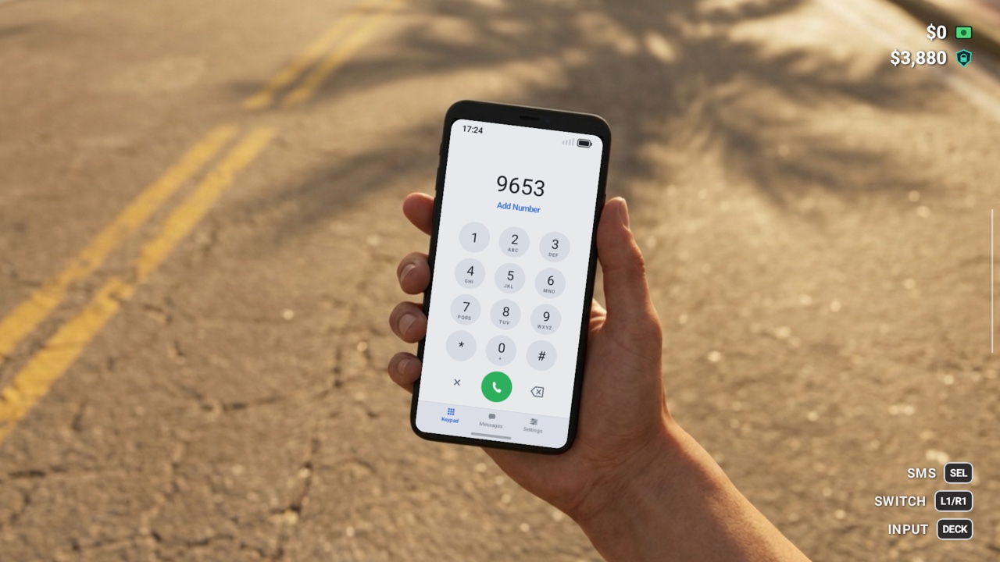
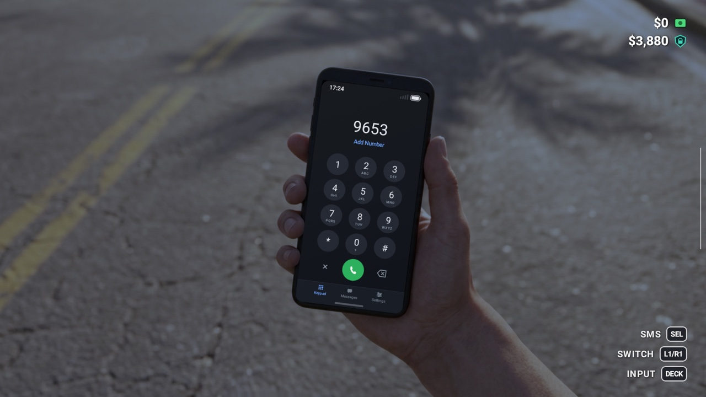
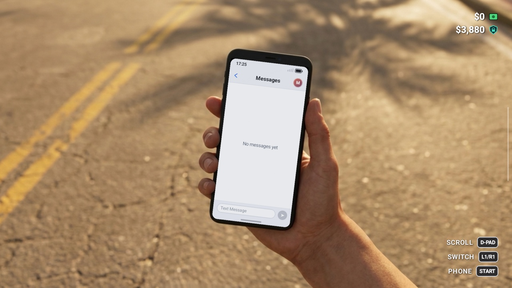
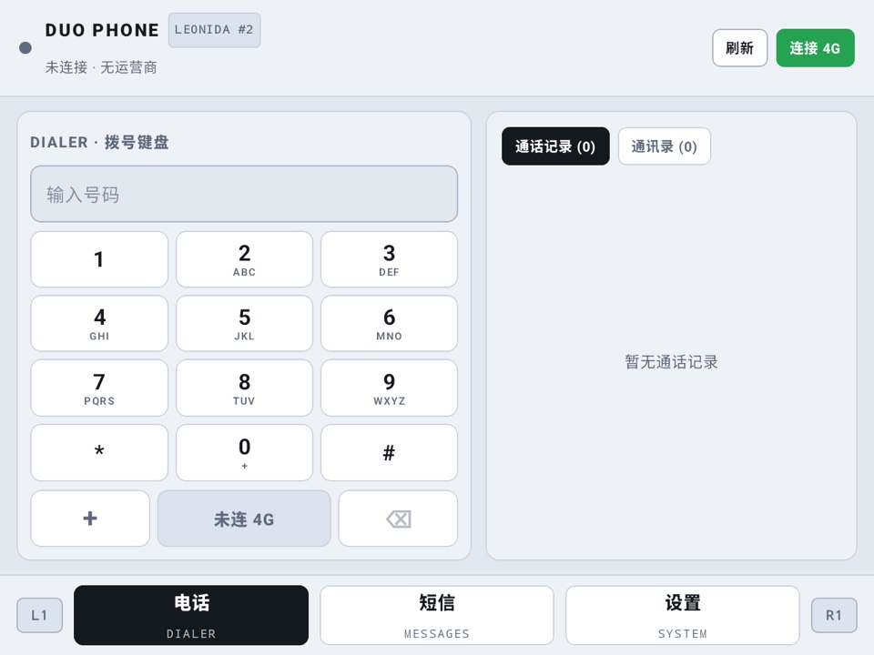
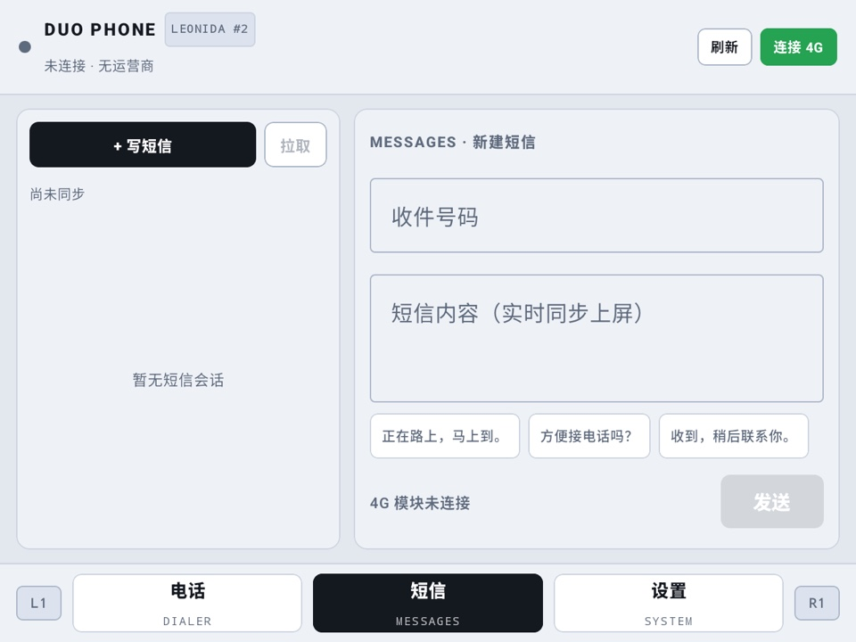
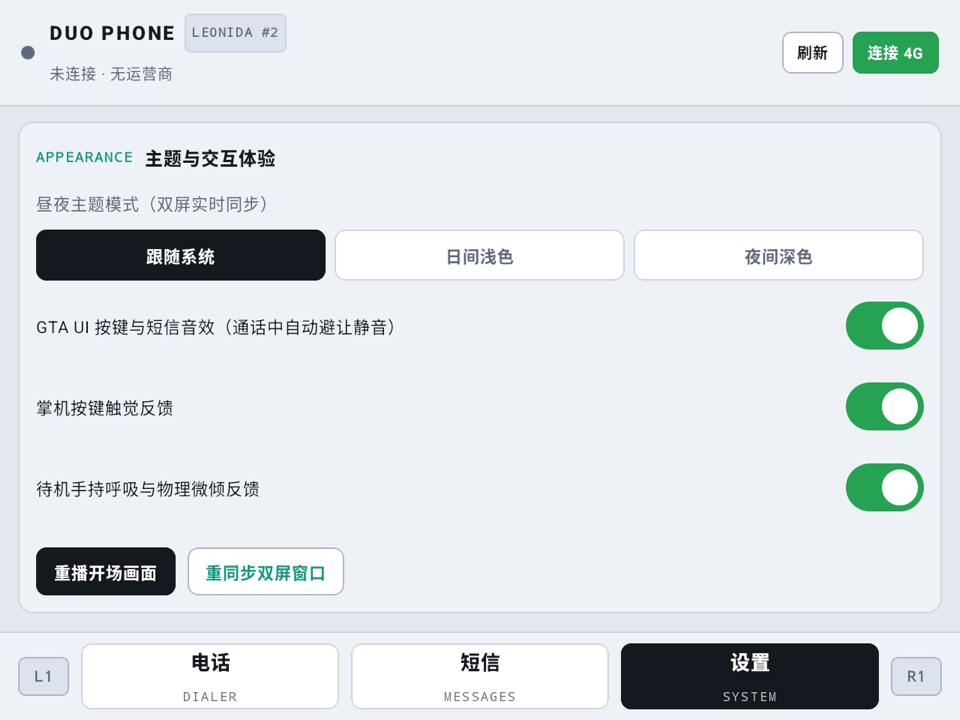
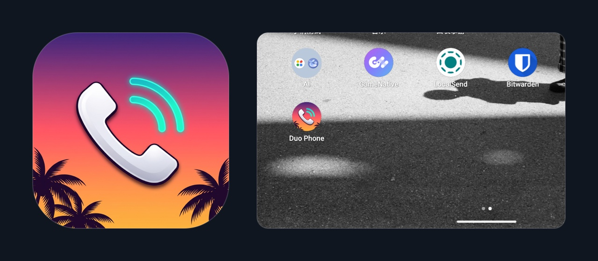

[中文](README.md) | [English](README_EN.md)

# Duo Phone

[-34B864?style=flat-square)](https://developer.android.com/)
[](https://kotlinlang.org/)
[](#hardware-compatibility--non-root-design)
[](#-built-with-gemini)
[](LICENSE)

A standalone, **non-root** Android cellular communication terminal built for the **Retroid Pocket Duo** dual-screen handheld (Android 16 / SDK 36) and the **DJI Cellular Dongle Gen 1 (QDC507 / MDM9207)** 4G USB modem.

Without rooting the handheld or flashing custom firmware onto the dongle, Duo Phone delivers **VoLTE voice calling, bidirectional 3GPP PDU SMS (Unicode & multipart), contact caller-ID matching, hardware gamepad controls**, and an immersive **GTA 6 (Vice City / Leonida) inspired dual-screen UI**.

---

## 📸 Visual Tour & App Icon

### Top Stage Display (`Display #0` · `1920×1080`)

The upper screen renders a first-person handheld smartphone stage with two interchangeable backends synchronized from one Kotlin state machine:
- **Default Compose Backend (`TopStageScreen` / `VirtualPhoneUi`)**: **Automatic Day/Night visual grading**, 4-corner homography projection (`PerspectiveQuadHost`, calibrated at flat `+7°` grip), subtle breathing motion, SMS bubble stream, and real-time signal/battery telemetry (enabled in default `debug` and all `release` builds).
- **Optional PocketJS + GLES2 Native Backend (`-PpocketUi=top`)**: Dual-pass **GLES2 offscreen FBO (`720×1280`) + `3×3` homography rounded-corner compositor** running **PocketJS `v0.12.0` + QuickJS + Rust `ui-cabi`**, featuring a clean pure T9 smartphone dialer, 60fps handheld breathing & key-press recoil, inverse-perspective touch mapping, GTA HUD overlays, and automatic Compose fallback (`dual` remains blocked due to upstream v0.12.0 singletons).

| Daylight Dialer Stage | Night Mode Dialer Stage | SMS Thread View |
| :---: | :---: | :---: |
|  |  |  |

### Bottom Console Deck (`Display #2` · `1280×960`)

The lower 4:3 screen provides a thumb-friendly control console covering **Dialer & Call Logs/Contacts**, **SMS Threads & Quick Composer**, and **Theme / Calibration / Hardware Diagnostics** — with full single-screen fallback when no secondary display is present, and **without a redundant bottom dial input box** (typed digits mirror live onto the top virtual phone display).

| Phone Console (Dialer / Logs / Contacts) | SMS Console (Threads / Composer / OTP) | Settings & Diagnostics Deck |
| :---: | :---: | :---: |
|  |  |  |

### Adaptive Launcher Icon (GTA 6 Vice Sunset Style)

Includes full `mdpi`–`xxxhdpi` adaptive foreground/background/legacy assets plus an Android 13+ monochrome themed vector layer:



---

## 🎮 Features & Operation Guide

### Hardware Compatibility & Non-Root Design
- **Supported Hardware**:
  - Handheld: **Retroid Pocket Duo** (Qualcomm CQ7790S, Android 16 / API 36, `Display #0` `1920×1080` + `Display #2` `1280×960`).
  - Modem: **DJI Cellular Dongle Gen 1 / QDC507** (`2CA3:4006`, compatible with `2C7C:0125`).
- **Safe USB Probing**: `UsbInterfaceClassifier` explicitly skips ADB (`FF/42/01`), UAC audio (`01/*/*`), Mass Storage (`08/*/*`), and blind `Diag IF0` probes, connecting cleanly to the AT serial control interface (`IF2`/`IF3`).
- **Strictly Reversible**: Never writes to modem boot/MTD/NV partitions or swaps firmware; optional voice runtime payloads are SHA-256 verified and staged strictly in `/tmp/duophone-voice` (wiped on reboot).

### Gamepad Controller Shortcuts (`Retroid Pocket Controller`)

| Button | Action |
| --- | --- |
| **`L1` / `R1`** | Switch between **Phone (Dialer)**, **Messages (SMS)**, and **System (Settings)** |
| **`START`** | Place a call when digits are entered; context-aware answer / hangup during calls |
| **`SELECT`** | Jump directly to **Messages (SMS)** |
| **`A` / `B` / `X` / `Y`** | Context-aware call controls (answer, reject, mute, speakerphone, hangup) |
| **`D-Pad`** | Navigate dialer focus, message threads, and contacts |

### Voice Calling, Privacy Masking & Two-Way Audio Bridge
- **Smart Dialer & Contacts**: Bottom dialpad taps mirror live onto the top virtual phone screen (redundant bottom dial input bar removed); supports local SQLite contacts plus optional `READ_CONTACTS` sync with local-priority deduplication.
- **Full-UI & Notification Phone Masking (`TopScreenPhoneMasker` / `PhoneMaskVisualTransformation`)**: Digits 4–7 of displayed phone numbers are masked as `*` across the top screen, bottom deck, legacy diagnostics workbench, SMS banners, and system notifications (e.g., `138****5678`, `+86138****5678`), while raw numbers remain intact internally for dialing, `AT+CMGS`, contact matching, and thread routing.
- **Side-Effect Protection**: Never auto-retries non-idempotent commands (`ATD`, `AT+CMGS`, `AT+CFUN=1,1`).
- **Bidirectional PCM Bridge (`AndroidAudioBridge`)**: Automatic hot-plug routing across Bluetooth, 3.5mm wired headset, earpiece, and speakerphone, paired with an `80 Hz–3400 Hz` speech bandpass filter, hardware `AEC`/`NS`/`AGC`, and speakerphone NLP echo suppression. Ringtone playback is pinned to local handheld outputs so USB UAC never hijacks ringing.

---

## 🧱 Tech Stack

| Layer / Domain | Core Technologies & Versions | Notes |
| --- | --- | --- |
| **Android Platform & Build** | Kotlin `2.2.10`, AGP `9.0.1`, Gradle `9.1.0`, OpenJDK `25` | `compileSdk 36` / `targetSdk 36` / `minSdk 26`; Release R8 minification & resource shrinking |
| **UI & Dual-Display** | Jetpack Compose (`BOM 2025.02.00`), Material 3, `activity-compose 1.10.1`, `lifecycle 2.8.7` | `DisplayManager` dual-display dispatch (`Display #0` Top + `Display #2` Deck) with single-screen fallback |
| **Media & Tactile SFX** | AndroidX Media3 ExoPlayer `1.5.1`, `AudioTrack` synthesized SFX | Opening video playback, controller cues, and haptic feedback |
| **Optional Native Top Renderer (`-PpocketUi=top`)** | PocketJS `v0.12.0` (Rust `ui-cabi`, `nightly-2026-07-02`), QuickJS `2026-06-04`, NDK `28.2.13676358` C/JNI, OpenGL ES 2.0 | 2-pass `720×1280` FBO + `3×3` perspective homography, rounded SDF, 60fps breathing/recoil, inverse-perspective touch; Pillow `11.3.0` baked Inter atlases, TypeScript `5.9.3` |
| **Concurrency & Storage** | Kotlin Coroutines `1.10.1` (`StateFlow` / `SharedFlow`), Android SQLite (`SQLiteOpenHelper` v2) | Serialized AT/URC state pipeline; local SMS, call log, contact cache & IMEI-indexed USB config backups |
| **Hardware Comm & Audio DSP** | Android USB Host API, clean-room USB ADB transport, 3GPP TS 23.040 PDU codec, `AudioRecord` / `AudioTrack` / `AudioDeviceCallback` | Safe USB interface probing, `80–3400 Hz` bandpass filter, `AEC`/`NS`/`AGC`, speaker NLP echo suppression |
| **Testing & Static Analysis** | JUnit 4 `4.13.2` + `kotlinx-coroutines-test`, Node `node:test`, AndroidX Instrumentation, Android Lint | **70 JVM unit tests** + **8 PocketJS contract tests** + **2 device instrumentation smoke tests** + 0-error Lint |

### 3GPP PDU SMS & OTP Quick Actions
- Full **3GPP TS 23.040 PDU** encoding/decoding for GSM 7-bit, UCS2 international text, UTF-16 surrogate-safe splitting, out-of-order UDH multipart reassembly, and alphanumeric sender IDs.
- Automatic OTP code detection with one-tap copy, notification **Direct Reply** (`RemoteInput`), and quick-reply presets on the bottom deck.

### Advanced Engineering Diagnostics Workbench
- Accessible via **Settings → Advanced Hardware & QDC507 Diagnostics Workbench** on the bottom deck:
  - Live USB descriptor & Android multi-display / power telemetry.
  - Interactive **AT Command Console** with preset queries and PII log redaction.
  - IMEI-keyed `AT+QCFG="usbcfg"` backup, guarded `adb/uac` switching with explicit confirmation dialogs, and one-click factory rollback.

### Hot-Swappable GTA Assets (No Recompile Needed)
Bundled stage assets live in `app/src/main/assets/gta/`. Override backgrounds, opening animations, or `stage_config.json` homography coordinates at runtime by pushing files to:
```bash
adb push stage_config.json /sdcard/Android/data/com.duophone.app/files/gta_assets/
adb push idle_hand_phone_light.png /sdcard/Android/data/com.duophone.app/files/gta_assets/
```
Then tap **Rescan Assets** inside the bottom **Settings** deck (see [README_ASSETS.txt](app/src/main/assets/gta/README_ASSETS.txt)).

---

## ✨ Built with Gemini

Duo Phone was designed, engineered, tested, and visually polished end-to-end with **Google Gemini** inside the Antigravity agentic development workflow:

- **Hardware & License Research**: Audited 5 reference projects, verified license boundaries (MIT vs. PolyForm vs. GPL-2.0 isolation), and profiled the physical Retroid Pocket Duo (`Android 16`, missing `telecom` service, dual display & hall-switch power behavior) to produce clean ADRs (`ADR-001`–`ADR-005`).
- **Modular Kotlin & Compose Engineering**: Built the 8-layer architecture covering serialized AT/URC framing, 3GPP PDU codecs, USB ADB wire transport, PCM voice conditioning, SQLite repositories, and foreground `ModemService` recovery.
- **Automated Testing & Device Verification**: Created **70 JVM unit tests**, **8 PocketJS JS contract tests**, and **2 device instrumentation smoke tests** covering protocol framing, phone masking, SMS PDU, call state, audio DSP, USB config, perspective quad geometry, and gamepad routing, iteratively verified on real hardware via `adb logcat` and display captures.
- **GTA 6 Visuals & Native Perspective**: Crafted the Day/Night handheld scene assets, 4-corner homography projection (`PerspectiveQuadHost` / `PocketQuadGeometry` GLES2 FBO), smartphone virtual UI, and Vice Sunset adaptive app icon.

---

## 🛠️ Build, Signing & Installation

### Prerequisites
- **JDK**: OpenJDK 25
- **Android SDK**: `compileSdk 36` / `targetSdk 36` / `minSdk 26`, Build Tools `36.0.0`
- **Build System**: Gradle 9.1.0 + AGP 9.0.1 (included via Gradle Wrapper)
- **Optional PocketJS Native Top Backend (`-PpocketUi=top` only)**: Rust `nightly-2026-07-02` (`aarch64-linux-android`), Android NDK `28.2.13676358`, Python 3 + `Pillow 11.3.0`, Node.js (`TypeScript 5.9.3`); see [`docs/pocketjs/README.md`](docs/pocketjs/README.md)

```bash
export JAVA_HOME=/path/to/jdk-25
export ANDROID_HOME=/path/to/Android/sdk

# Run all 70 JVM unit tests and 8 PocketJS contract tests
./gradlew testDebugUnitTest
npm --prefix pocket-ui test

# Run Android Lint checks
./gradlew lintDebug

# Build default Compose Debug APK
./gradlew assembleDebug

# Optional: build PocketJS + GLES2 perspective Top Debug APK (bottom remains Compose; full 4G unlocked)
# Note: -PpocketUi=dual stays rejected due to PocketJS v0.12.0 global singletons
./gradlew -PpocketUi=top assembleDebug
```

### Signed Release Build

Private signing keys (`*.jks`, `*.keystore`, `keystore.properties`) are strictly gitignored. Configure release signing using [`keystore.properties.example`](keystore.properties.example):

```bash
cp keystore.properties.example keystore.properties
# Fill in storeFile / storePassword / keyAlias / keyPassword (or pass DUOPHONE_* env vars)

./gradlew assembleRelease
# Output: app/build/outputs/apk/release/DuoPhone-v1.0.0-release.apk
```

### Install on Retroid Pocket Duo

```bash
# Wireless ADB is recommended so the USB-C port remains free for the QDC507 dongle
adb install -r app/build/outputs/apk/release/DuoPhone-v1.0.0-release.apk
adb logcat -s DUO_USB DUO_AT DUO_URC DUO_SMS DUO_CALL DUO_AUDIO DUO_MODEM DUO_DISPLAY DUO_INPUT DUO_SERVICE
```

---

## 📁 Project Structure

```text
├── app/src/main/
│   ├── assets/gta/            # Bundled Day/Night GTA 6 assets & stage_config.json
│   ├── cpp/pocket/            # Optional PocketJS + QuickJS + GLES2 FBO JNI compositor & host_smoke
│   ├── java/com/duophone/app/
│   │   ├── ui/                # Dual-display helper, PhoneMaskVisualTransformation & diagnostics workbench
│   │   │   └── gta/           # Top Stage (PerspectiveQuadHost / VirtualPhoneUi) & Bottom Console Deck
│   │   ├── pocket/            # Optional PocketJS protocol mapper, GLES2 Surface host & quad geometry
│   │   ├── stage/             # Stage coordinator, TopScreenPhoneMasker, SFX triggers & asset repository
│   │   ├── domain/            # Call state machine, Modem state controller, SMS controller
│   │   ├── service/           # Foreground ModemService, masked notifications & quick action receivers
│   │   ├── protocol/          # AT engine, URC parser, 3GPP PDU codec
│   │   ├── audio/             # Two-way PCM audio bridge, voice DSP/AEC, ringtone & UI SFX
│   │   ├── device/            # Safe USB interface probing, USB ADB client, QDC507 voice runtime & backups
│   │   ├── data/              # SQLite repositories (SMS, call logs, contacts)
│   │   └── diagnostics/       # Redacted logger (DuoLogger) & hardware snapshots
│   └── res/                   # Vice Sunset adaptive & legacy launcher icons (mdpi..xxxhdpi)
├── pocket-ui/                 # Optional PocketJS guest UI (top.js, build.py font baker, TS & JS tests)
├── scripts/                   # build-pocketjs.sh & test-pocketjs-host.sh helpers
└── docs/pocketjs/             # PocketJS build/acceptance docs & MIT/OFL licenses
```

---

## 📄 License & Disclaimer

- **License**: Released under the **[MIT License](LICENSE)**. Third-party protocol research attributions and license boundaries are documented in [`THIRD_PARTY_NOTICES.md`](THIRD_PARTY_NOTICES.md) and [`docs/LICENSE_AUDIT.md`](docs/LICENSE_AUDIT.md); optional PocketJS (`MIT`), QuickJS (`MIT`), and Inter (`OFL`) license texts live in [`docs/pocketjs/licenses/`](docs/pocketjs/licenses/).
- **Privacy**: Phone numbers (digits 4–7 masked as `*` in UI & notifications), IMEI, IMSI, ICCID, SMS bodies, and OTPs are protected locally by default; zero data is transmitted to external servers.
- **Disclaimer**: Independent unofficial open-source project with no affiliation to DJI, Quectel, or Retroid/Moorechip. **Do not rely on this application as a primary emergency calling device (`110` / `119` / `120` / `911` / `112`).**
