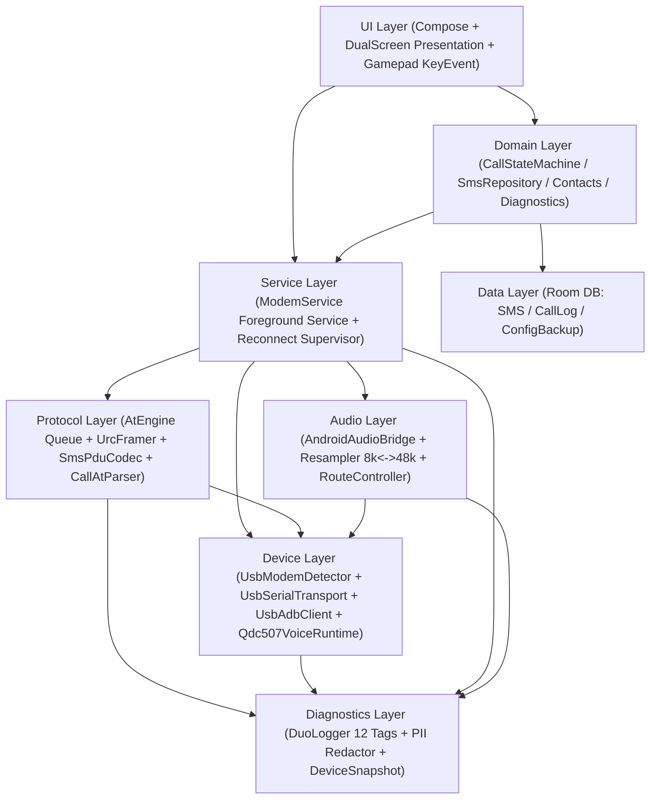
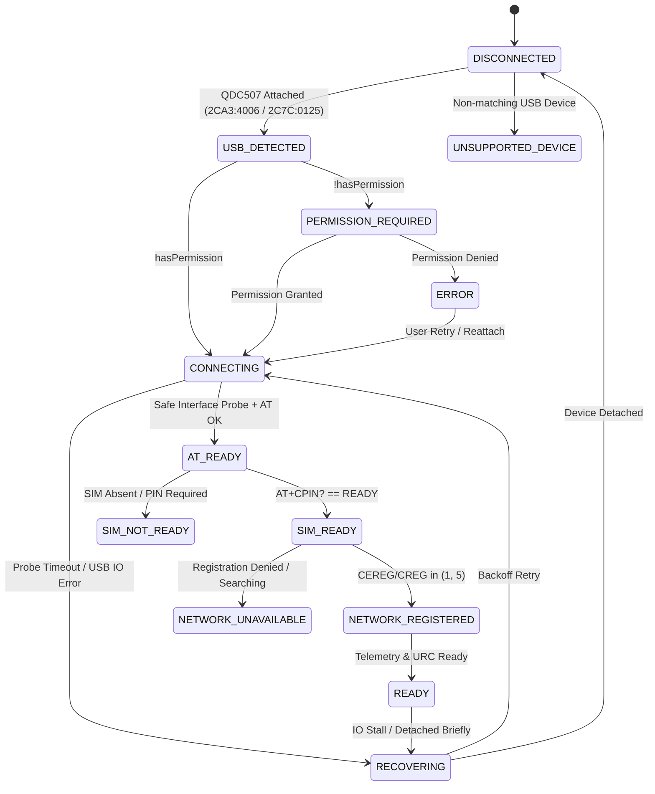

# 系统架构设计 (`ARCHITECTURE.md`)

## 1. 技术栈选型
- **语言**: Kotlin（AGP 9.x 内置 Kotlin）+ 必要时 C/C++ NDK (`ndk 28.2.13676358`, `cmake 3.22.1`)
- **UI**: Jetpack Compose + Material 3（深色掌机通信主题，天然支持焦点导航与双屏拆分）
- **并发与响应式**: Kotlin Coroutines + `StateFlow` / `SharedFlow`
- **持久化**: Room / SQLite（短信、通话记录、联系人缓存、按 IMEI 索引的模块配置备份）
- **USB 通信**: Android USB Host API（`UsbManager`, `UsbDevice`, `UsbDeviceConnection`, `UsbInterface`, `UsbEndpoint`）
- **后台保活**: Android Foreground Service (`ModemService`，Android 16 / SDK 36 合规类型：`connectedDevice` + 通话期间 `microphone`/`phoneCall` 评估)
- **双屏适配**: `DisplayManager` + `Presentation` / Secondary Display Activity（利用实机已验证的 `android.software.activities_on_secondary_displays`）
- **音频桥接**: 优先 Android 原生 `AudioRecord` / `AudioTrack` / `AudioManager` (`setPreferredDevice` + `AudioDeviceInfo`)，备选模块 PCM 桥接协议与 NDK Oboe/AAudio

## 2. 八层模块架构

## 3. 连接状态机

## 4. 关键架构边界
1. **单通道 AT 串行队列**：所有 AT 指令经由 `AtEngine` 独占锁与有序队列发出；后台持续读取 Bulk IN 字节流，按 `\r\n` 实时拆帧。异步 URC（`RING`, `+CLIP:`, `+CMTI:`, `+CMT:`, `NO CARRIER`, `BUSY`, `NO ANSWER`, `+CEREG:`, `+CREG:`）由 `UrcFramer` 分流至 `SharedFlow`，不会污染同步命令响应，也不允许因为某条命令占用而静默丢弃来电/新短信事件。
2. **USB 接口隔离**：`UsbModemTransport` 仅 claim 探测命中的 AT 接口；绝不误占 ADB (`FF/42/01`) 或 UAC (`01/*/*`)，从而保证 Phase 4 可以并发通过 ADB 管理语音运行时、通过 UAC 传输音频。
3. **不依赖系统 Telecom**：由于 Retroid Pocket Duo 实测缺失 `telecom` 服务，全套呼叫状态机、来电全屏通知、响铃与音频路由均由 `ModemService` 独立闭环管理。
