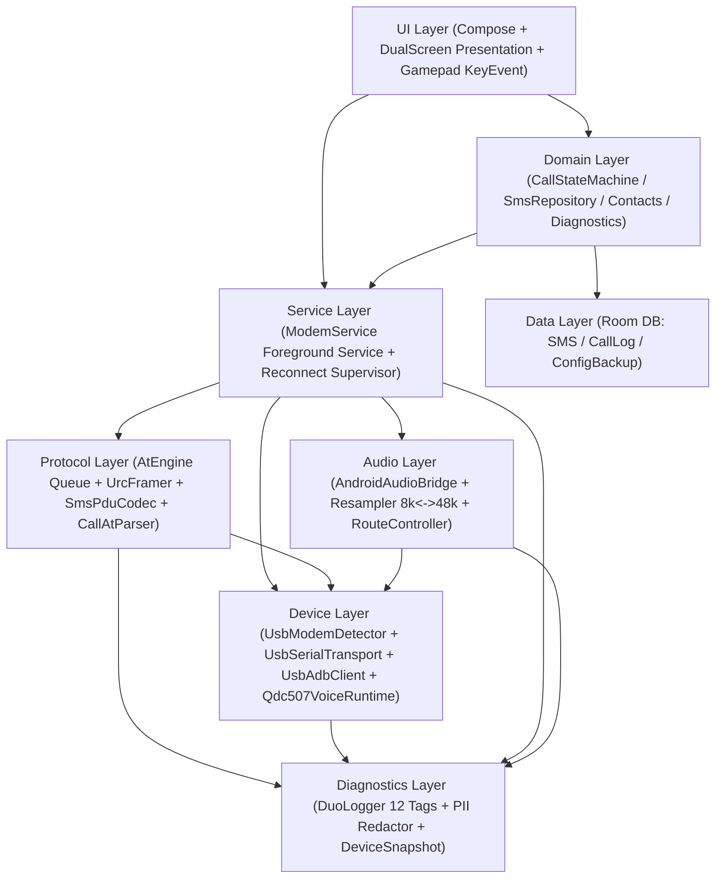
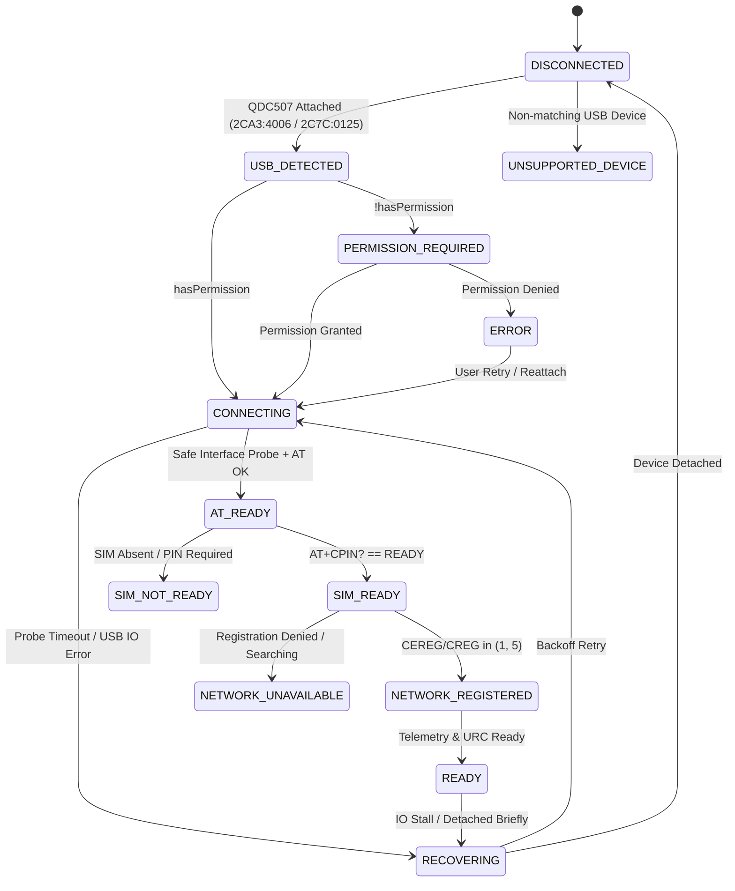

# 系统架构设计 (`ARCHITECTURE.md`)

## 1. 技术栈选型
- **核心语言与构建工具**: Kotlin `2.2.10`（AGP `9.0.1` + Gradle `9.1.0` + OpenJDK `25`，`compileSdk 36` / `targetSdk 36` / `minSdk 26`）+ Android NDK `28.2.13676358`
- **UI 与双屏展示**: Jetpack Compose（BOM `2025.02.00`）+ Material 3（`activity-compose 1.10.1`、`lifecycle 2.8.7`）+ Media3 ExoPlayer `1.5.1`；利用 `DisplayManager`（`Display #0` + `Display #2`）拆分上下双屏，支持单屏降级
- **可选上屏原生后端 (`-PpocketUi=top`)**: PocketJS `v0.12.0`（Rust `ui-cabi` 核心，`nightly-2026-07-02`）+ QuickJS `2026-06-04` + OpenGL ES 2.0 双通道 FBO 透视合成器（`720×1280` 离屏 FBO、`3×3` 单应性矩阵、圆角 SDF、60fps 手持呼吸/按键回弹与逆透视触控映射），并支持异常自动回退 Compose；`dual` 因上游单例限制保持拒绝
- **并发与响应式**: Kotlin Coroutines `1.10.1` + `StateFlow` / `SharedFlow`
- **持久化**: Android 原生 SQLite（`SQLiteOpenHelper` schema v2：短信、通话记录、通讯录缓存、按 IMEI 索引的模块配置备份）
- **USB 与协议通信**: Android USB Host API（`UsbManager`, `UsbDevice`, `UsbDeviceConnection`）、Clean-room USB ADB 协议栈、3GPP TS 23.040 PDU 编解码
- **后台保活**: Android Foreground Service (`ModemService`，Android 16 / SDK 36 合规类型：`connectedDevice`)
- **音频桥接**: 原生 `AudioRecord` / `AudioTrack` / `AudioDeviceCallback`（`80–3400 Hz` 带通滤波、`AEC`/`NS`/`AGC`、NLP 回声压制与热插拔路由）
- **隐私展示与日志脱敏**: UI 层统一通过 `TopScreenPhoneMasker` + `PhoneMaskVisualTransformation` 将展示号码第 4–7 位脱敏为 `*`（保留底层拨号与联系人匹配真实值），日志层由 `PiiRedactor` 自动脱敏敏感字段

## 2. 八层模块架构

## 3. 连接状态机

## 4. 关键架构边界
1. **单通道 AT 串行队列**：所有 AT 指令经由 `AtEngine` 独占锁与有序队列发出；后台持续读取 Bulk IN 字节流，按 `\r\n` 实时拆帧。异步 URC（`RING`, `+CLIP:`, `+CMTI:`, `+CMT:`, `NO CARRIER`, `BUSY`, `NO ANSWER`, `+CEREG:`, `+CREG:`）由 `UrcFramer` 分流至 `SharedFlow`，不会污染同步命令响应，也不允许因为某条命令占用而静默丢弃来电/新短信事件。
2. **USB 接口隔离**：`UsbModemTransport` 仅 claim 探测命中的 AT 接口；绝不误占 ADB (`FF/42/01`) 或 UAC (`01/*/*`)，从而保证 Phase 4 可以并发通过 ADB 管理语音运行时、通过 UAC 传输音频。
3. **不依赖系统 Telecom**：由于 Retroid Pocket Duo 实测缺失 `telecom` 服务，全套呼叫状态机、来电全屏通知、响铃与音频路由均由 `ModemService` 独立闭环管理。
